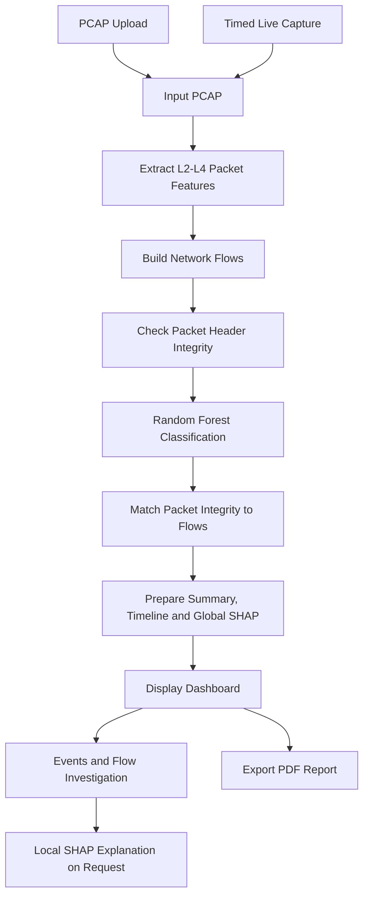

# NetworkIDS

An Explainable and Robust L2-L4 Header and Flow-Based Intrusion Detection System.

## Project Objectives

1. Extract L2-L4 header and flow features from network traffic.
2. Train a machine learning model for traffic classification.
3. Provide explainable predictions using SHAP.
4. Validate packet header integrity using rule-based checks.
5. Evaluate model robustness under controlled L2-L4 header perturbations.

## Technologies

- Python
- Scapy
- Pandas
- NumPy
- Scikit-learn
- SHAP
- Matplotlib

## 1. System Overview

NetworkIDS is a Final Year Project (FYP) prototype of a Network Intrusion Detection System (NIDS) designed to support Security Operations Centre (SOC) analysts and incident response personnel in network traffic analysis and investigation.

The system extracts Layer 2–Layer 4 packet header and flow features from uploaded PCAP/PCAPNG files or timed live network captures. It uses a trained Random Forest model to classify network flows as Attack or Benign, SHAP (SHapley Additive exPlanations) to explain model predictions, and independent rule-based checks to assess packet header integrity.

NetworkIDS provides a Flask-based web interface for reviewing analysis results, investigating individual flows and exporting security analysis reports. It supports Windows native deployment and Linux Docker deployment.

## 2. Main Features

- **PCAP Analysis:** Upload and analyse one `.pcap` or `.pcapng` file at a time, subject to the configured 512 MB request limit.
- **Live Capture:** Capture network traffic from the default active IPv4 network interface for 10–300 seconds, then automatically analyse the saved capture.
- **Threat Classification:** Classify network flows as Attack or Benign using a pre-trained Random Forest model.
- **Header Integrity Checking:** Apply ten rules and indicators to packet header features, producing Intact, Suspicious or Tampered integrity states. Invalid Layer 4 checksums are recorded as additional indicators rather than independently changing the integrity state.
- **SHAP Explainability:** Display global feature importance on the Dashboard and generate local feature contributions and plain-language explanations on demand for selected flows.
- **Dashboard:** Review classification statistics, protocol distributions, integrity findings, top attack sources, destinations and ports.
- **Events Investigation:** Review traffic timelines, search and filter flows, view flow details, triggered integrity rules and related packet records.
- **PDF Report Export:** Download a security analysis report generated from the current analysis results.
- **Robustness Evaluation:** Evaluate the trained model under controlled header-feature perturbations as a separate offline experiment, outside the web application workflow.

## 3. System Workflow



## 4. Requirements

| Component | Requirement |
| --- | --- |
| Operating system | Windows or Linux (Ubuntu recommended for Docker deployment) |
| Python | A version compatible with the project dependencies and trained model |
| Python dependencies | Listed in `requirements.txt` |
| Windows live capture | Npcap |
| Linux Docker deployment | Docker Engine and Docker Compose plugin |
| Machine learning model | Pre-trained Random Forest model configured in `src/config.py` |
| Web browser | A modern browser such as Chrome, Edge or Firefox |

Main Python libraries: Flask, Scapy, NumPy, pandas, scikit-learn, joblib, SHAP and ReportLab. Gunicorn is used for the Linux Docker deployment.

## 5. Setup and Installation

Download or clone the NetworkIDS project and make sure the trained Random Forest model is available before starting the application. Run the following commands from the project root (the directory containing `app.py`).

### 5.1 Windows — Native Deployment

#### Step 1: Install Python and Npcap

- Python: <https://www.python.org/downloads/>
- Npcap: <https://npcap.com/#download>

Npcap is required for live packet capture on Windows. If it is already installed and working, reinstallation is unnecessary. Use an Administrator PowerShell session if capture permissions require it.

#### Step 2: Open the project directory

```powershell
cd C:\NetworkIDS
```

Replace the path with your actual project location if necessary.

#### Step 3: Create and activate a virtual environment

```powershell
python -m venv .venv
.\.venv\Scripts\Activate.ps1
```

If the virtual environment already exists, only run the activation command.

#### Step 4: Install the Python dependencies

```powershell
python -m pip install -r requirements.txt
```

#### Step 5: Start the application

```powershell
python app.py
```

Open the following address in a web browser:

<http://127.0.0.1:5000>

To stop the application, press `Ctrl+C` in the terminal.

### 5.2 Ubuntu — Docker Deployment

#### Step 1: Install Docker

Install Docker Engine and the Docker Compose plugin by following the official Ubuntu installation instructions:

<https://docs.docker.com/engine/install/ubuntu/>

#### Step 2: Transfer the project to Ubuntu

Copy the complete NetworkIDS project, including `Dockerfile`, the Compose configuration, `requirements.txt`, source files, web assets and trained model, to the Ubuntu machine or VM.

#### Step 3: Open the project directory

```bash
cd ~/NetworkIDS
```

Replace the path if the project is stored elsewhere.

#### Step 4: Build and start the Docker container

```bash
sudo docker compose up -d --build
```

Use the existing Compose configuration for live capture, including host networking and the required network capture capabilities (`NET_RAW` and `NET_ADMIN`).

#### Step 5: Access the web application

From a browser on a machine that can reach the Ubuntu host, open:

```text
http://<Ubuntu-IP>:5000
```

For example, the IDS VM in the project test environment used `http://192.168.72.133:5000`.

To stop the container:

```bash
sudo docker compose down
```

After updating the application files, rebuild and restart the container:

```bash
sudo docker compose up -d --build
```

## 6. Usage

### PCAP Upload

1. Open NetworkIDS and select the PCAP Upload mode.
2. Select or drag and drop a supported capture file.
3. Click **Analyze Network Traffic**.
4. Review the Dashboard after analysis completes.

### Live Capture

1. Select **Live Capture**.
2. Enter a capture duration between 10 and 300 seconds.
3. Click **Start Capture**.
4. Review the Dashboard after capture and analysis complete.

### Reviewing Results

1. Review the Dashboard statistics and global SHAP feature importance.
2. Open **Events** to search, filter and investigate network flows.
3. Click **View** to inspect flow details, integrity findings and related packets.
4. Expand the SHAP explanation section to examine local feature contributions.
5. Return to the Dashboard and click **Export PDF** to download the analysis report.

## 7. Notes and Limitations

- A trained Random Forest model must be available at the path specified by `RANDOM_FOREST_MODEL_FILE` in `src/config.py`. Model retraining is not required for normal application use.
- Only the latest analysis is retained in `runtime/current/`. Starting a new analysis replaces the previous results. Export any required report before starting another analysis.
- The current application uses local files and in-memory state rather than a database. Restarting the backend clears the in-memory analysis state.
- Live capture is time-bounded rather than continuous real-time intrusion monitoring. It is also limited to 100,000 packets or the configured capture byte limit.
- The capture interface is selected automatically. NetworkIDS can only analyse traffic visible to that interface.
- Use compatible dependency versions when loading the supplied trained model.
- Perform traffic capture and security testing only on systems and networks where you have permission.

